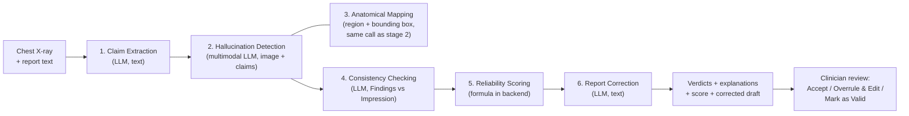

<div align="center">

# LLM-Guided Multimodal Radiology Report Consistency and Hallucination Detection

### Detecting AI-Generated Errors in Chest X-Ray Reports Through Multimodal Cross-Verification

A full-stack research platform that extracts clinical claims from a radiology report, checks each claim against the chest X-ray using a multimodal LLM, maps claims to anatomical regions, finds contradictions between the Findings and Impression sections, scores the report's reliability (0–100), and drafts a corrected report for clinician review.

**Undergraduate Thesis · BRAC University**

[](https://react.dev/)
[](https://expressjs.com/)
[](https://fastapi.tiangolo.com/)
[](https://mongoosejs.com/)
[]()

</div>

---

## The Problem

AI-generated radiology reports are becoming common in clinical workflows, but they can contain **hallucinated findings**: clinically plausible statements that have no basis in the actual medical image. A report might say "lungs are clear bilaterally" when the X-ray shows opacities, or "no pleural effusion" when one is visible. These errors carry real clinical risk.

This platform addresses two failure modes:

1. **Image–report hallucination**: claims in the report that the chest X-ray does not support
2. **Internal inconsistency**: contradictions between the Findings and Impression sections of the same report (for example, a finding described in Findings but negated in Impression)

---

## How It Works

Every submitted report goes through a **6-stage pipeline**. Four stages are LLM calls to the FastAPI service, one stage (anatomical mapping) is returned inside the hallucination-detection call, and one stage (reliability scoring) is a deterministic formula computed in the Express backend.



### Stage Details

| # | Stage | Where it runs | Input | Output |
|---|---|---|---|---|
| 1 | **Claim Extraction** | `POST /claims/extract` | Report text | Atomic clinical claims, each tagged with an anatomical region |
| 2 | **Hallucination Detection** | `POST /hallucination/detect` | X-ray image URL + all claims (one multimodal call) | Per-claim verdict (`supported` / `uncertain` / `hallucinated`), risk score (0–100), explanation |
| 3 | **Anatomical Mapping** | Returned by the stage 2 call | Claim regions from stage 1 + the image | Bounding box per claim, as percentages of image width/height, drawn on the X-ray in the results view |
| 4 | **Consistency Checking** | `POST /consistency/check` | Report text | Findings ↔ Impression contradictions, each with the two sentences and an explanation |
| 5 | **Reliability Scoring** | Express backend (`pipelineService.js`) | Stage 2 verdicts + stage 4 violation count | Reliability score (0–100) |
| 6 | **Report Correction** | `POST /correction/correct` | Original report + flagged claims + violations | Corrected report + list of changes. Runs only when at least one claim is not `supported` or a violation was found |

Risk score meaning: 0 = fully supported by the image, 50 = cannot confirm or deny, 100 = clearly contradicted. Stages 1, 2 and 4 use temperature 0.2; stage 6 uses 0.3.

### Reliability Score

```
base    = (supported × 100 + uncertain × 50 + hallucinated × 0) / total_claims
penalty = min(violation_count × 10, 30)
score   = max(round(base − penalty), 0)
```

| Score | Band | Suggested action |
|---|---|---|
| 66–100 | High (green) | Quick review |
| 36–65 | Moderate (orange) | Review flagged claims and the corrected draft |
| 0–35 | Low (red) | Review the whole report against the image |

The bands are provisional. Because the base score averages over all claims, a single hallucinated claim in a long report can still land in the green band (see [Evaluation](#evaluation)).

### Pipeline Status and Retries

The backend updates `Analysis.status` as it runs: `processing` → `extracting_claims` → `detecting_hallucinations` → `checking_consistency` → `complete` (or `failed`). The frontend polls this every 3 seconds to show progress.

OpenRouter rate limits are handled in two layers: `aiService.js` retries a call up to 50 times, 3 seconds apart, when the AI service reports HTTP 429; if those are exhausted, `pipelineService.js` restarts that stage up to 3 times, 5 seconds apart.

---

## Evaluation

The Pre-Thesis 2 evaluation ran the full pipeline (through the backend API) on 200 IU-Xray samples. Scripts live in `evaluation/scripts/` (currently on the `swapnil` branch).

**Data.** 200 reports from IU-Xray, one frontal X-ray each, converted to grayscale PNG and resized so the longest side is at most 1024 px. 100 reports were left unchanged and 100 were corrupted by a rule-based script (`build_ground_truth.py`, fixed random seed) with one of four error types: fabrication (32), negation (28), contradiction (39) and anatomy swap (1).

**Scoring.** Report-level, binary. A report counts as flagged when at least one claim is `hallucinated`; for contradiction-type samples, a consistency violation also counts (`score_results.py`).

| Metric | Value | 95% CI |
|---|---|---|
| Precision | 82.4% (61/74) | 72.2–89.4% |
| Recall | 61.0% (61/100) | 51.2–70.0% |
| F1 | 70.1% | 61.8–77.4% |
| Accuracy | 74.0% (148/200) | 67.5–79.6% |

| Corruption type | Detected |
|---|---|
| Fabrication | 32/32 (100%) |
| Negation | 21/28 (75%) |
| Contradiction | 7/39 (18%) |
| Anatomy swap | 1/1 (single sample, not conclusive) |

Mean reliability score: 94.3 for clean reports and 79.2 for corrupted reports. 32 of the 39 missed reports are contradiction-type, so consistency checking is the main target for improvement. Correction quality was not measured in this round.

---

## Tech Stack

| Layer | Technology | Purpose |
|---|---|---|
| **Frontend** | React 19, React Router 7, Tailwind CSS 3, Recharts 3, Lucide icons | Upload UI, pipeline progress, results view, history, analytics, admin panel |
| **Backend API** | Express 5, Node.js, Mongoose 9 | Auth, sessions, analysis CRUD, pipeline orchestration, reliability scoring |
| **AI Service** | Python FastAPI, OpenAI SDK pointed at the OpenRouter API | Claim extraction, hallucination detection + anatomical mapping, consistency checking, report correction |
| **Database** | MongoDB (Mongoose ODM) | Users, analyses, audit logs, sessions, teams, annotations |
| **Image Storage** | Cloudinary | Chest X-ray hosting; the model receives the image by URL |
| **Security** | JWT (access + refresh), TOTP 2FA (Speakeasy), AES-256-CBC, Helmet, express-rate-limit | Auth, data protection, audit trail |

### Default AI Model

`google/gemma-4-31b-it:free` via [OpenRouter](https://openrouter.ai/), set through `AI_MODEL` in `.env`. Because the AI service uses the OpenAI SDK against OpenRouter's API, switching models only requires changing that variable. The same model is used for every LLM stage, with a different prompt per stage.

---

## Security Architecture

| Feature | Implementation |
|---|---|
| **Authentication** | JWT access + refresh token pair; refresh token in an httpOnly cookie |
| **Two-Factor Auth** | TOTP via Speakeasy with QR code enrollment |
| **Data Encryption** | Report text encrypted at rest with AES-256-CBC (random IV per record) |
| **Rate Limiting** | express-rate-limit: 100 requests / 15 min per IP on `/api`, 50 / 15 min on register and login |
| **Upload Validation** | Multer with type and size checks (JPEG/PNG, 10 MB max) |
| **Audit Logging** | Auth, 2FA, session, analysis and admin actions logged with user ID, IP and timestamp |
| **RBAC** | Three roles: `general_user`, `clinician`, `admin`, enforced in middleware |

---

## Project Structure

```
├── client/                         # React frontend (CRA + Tailwind)
│   ├── src/
│   │   ├── api/                    # Axios instance + auth, analysis, admin endpoint modules
│   │   ├── components/
│   │   │   ├── common/             # ReliabilityGauge, StatusBadge, SectionHeader
│   │   │   ├── layout/             # Layout, Navbar, Sidebar, NotificationDropdown
│   │   │   └── results/            # ClaimRow, ImageViewer (bounding boxes), ReportComparison
│   │   ├── context/                # AuthContext, ThemeContext
│   │   ├── pages/
│   │   │   ├── admin/              # 8 admin sub-pages: users, model config, quotas, metrics,
│   │   │   │                       #   audit logs, announcements, feedback, research export
│   │   │   ├── LoginPage.jsx, RegisterPage.jsx, TwoFactorPage.jsx
│   │   │   ├── DashboardPage.jsx
│   │   │   ├── UploadPage.jsx      # Drag-and-drop X-ray + report text submission
│   │   │   ├── ProcessingPage.jsx  # Pipeline progress (polls status every 3 s)
│   │   │   ├── ResultsPage.jsx     # Claim verdicts, image viewer, report comparison
│   │   │   ├── HistoryPage.jsx     # Past analyses
│   │   │   ├── AnalyticsPage.jsx   # Usage charts (Recharts)
│   │   │   ├── SettingsPage.jsx
│   │   │   └── AdminPage.jsx
│   │   └── utils/                  # PDF export
│   └── package.json
│
├── server/                         # Express backend (CommonJS)
│   ├── config/                     # MongoDB + Cloudinary setup
│   ├── controllers/                # Auth, analysis, admin, session, 2FA
│   ├── middleware/                 # JWT protect, rate limiter, upload validator
│   ├── models/                     # 10 Mongoose schemas
│   ├── routes/                     # Auth, analysis, session, admin
│   ├── services/
│   │   ├── pipelineService.js      # 6-stage pipeline orchestrator + reliability score, step restarts
│   │   ├── aiService.js            # HTTP client to FastAPI with 429 retry logic
│   │   └── cloudinaryService.js    # Image upload
│   ├── utils/                      # AES-256 encryption, audit logger
│   └── server.js                   # Entry point
│
├── ai-service/                     # Python FastAPI microservice
│   ├── main.py                     # App + CORS + router registration
│   ├── routers/
│   │   ├── claims.py               # POST /claims/extract           (stage 1)
│   │   ├── hallucination.py        # POST /hallucination/detect     (stages 2 + 3)
│   │   ├── consistency.py          # POST /consistency/check        (stage 4)
│   │   ├── correction.py           # POST /correction/correct       (stage 6)
│   │   └── gemini_client.py        # OpenRouter client (OpenAI SDK); name kept from an earlier Gemini version
│   └── requirements.txt
│
├── evaluation/                     # IU-Xray evaluation (on the `swapnil` branch)
│   ├── scripts/                    # subset selection, image prep, ground truth, run + score, charts
│   └── charts/                     # confusion matrix, detection by type, metrics, score distribution
│
├── .env.example                    # All required environment variables
└── .gitignore
```

---

## Local Development

### Prerequisites

- **Node.js 18+** and **npm**
- **Python 3.10+** and **pip**
- **MongoDB** (local or [Atlas](https://cloud.mongodb.com/) free tier)
- A [Cloudinary](https://cloudinary.com/) account (free tier works)
- An [OpenRouter](https://openrouter.ai/) API key (free models available)

### 1. Clone

```bash
git clone https://github.com/swapnilrob/LLM-Guided-Multimodal-Radiology-Report-Consistency-and-Hallucination-Detection.git
cd LLM-Guided-Multimodal-Radiology-Report-Consistency-and-Hallucination-Detection
```

### 2. Environment Variables

```bash
cp .env.example .env
```

Fill in these values in `.env`:

```env
# Server
PORT=5000
NODE_ENV=development
CLIENT_URL=http://localhost:3000
MONGODB_URI=mongodb://localhost:27017/radiology_detector

# Auth
JWT_SECRET=<random-string-32-chars-min>
JWT_REFRESH_SECRET=<another-random-string>

# Cloudinary (from your dashboard)
CLOUDINARY_CLOUD_NAME=your_cloud_name
CLOUDINARY_API_KEY=your_api_key
CLOUDINARY_API_SECRET=your_api_secret

# AI Service
AI_SERVICE_URL=http://localhost:8000
OPENROUTER_API_KEY=your_openrouter_key
AI_MODEL=google/gemma-4-31b-it:free

# Encryption (generate: node -e "console.log(require('crypto').randomBytes(32).toString('hex'))")
ENCRYPTION_KEY=<64-char-hex-string>

# Email (optional, for notifications)
EMAIL_USER=your_email@example.com
EMAIL_PASS=your_app_password

# Frontend
REACT_APP_API_URL=http://localhost:5000
```

### 3. Start the AI Service

```bash
cd ai-service
pip install -r requirements.txt
uvicorn main:app --reload --port 8000
```

### 4. Start the Backend

```bash
cd server
npm install
npm run dev
```

### 5. Start the Frontend

```bash
cd client
npm install
npm start
```

The app opens at `http://localhost:3000`.

---

## API Reference

All backend routes are under `/api`. `GET /api/health` returns the server status.

### Auth: `/api/auth`

| Method | Endpoint | Access | Description |
|---|---|---|---|
| `POST` | `/register` | Public | Create account |
| `POST` | `/login` | Public | Get JWT access + refresh tokens |
| `POST` | `/refresh` | Public | Rotate access token via refresh cookie |
| `POST` | `/logout` | Public | Clear refresh cookie |
| `GET` | `/me` | Private | Current user profile |
| `POST` | `/2fa/setup` | Private | Generate TOTP secret + QR code |
| `POST` | `/2fa/verify` | Private | Verify TOTP code and enable 2FA |
| `POST` | `/2fa/disable` | Private | Disable 2FA |

### Sessions: `/api/sessions`

| Method | Endpoint | Access | Description |
|---|---|---|---|
| `GET` | `/` | Private | List the user's active sessions |
| `DELETE` | `/:sessionId` | Private | Revoke a session |

### Analyses: `/api/analyses`

| Method | Endpoint | Access | Description |
|---|---|---|---|
| `POST` | `/` | Private | Submit X-ray image (`image` field) + report text; starts the pipeline |
| `GET` | `/` | Private | List the user's analyses (summary view) |
| `GET` | `/:id` | Private | Full analysis: claims, verdicts, bounding boxes, violations, score, corrected report |
| `DELETE` | `/:id` | Private | Delete an analysis |

### Admin: `/api/admin` (admin role only)

| Method | Endpoint | Description |
|---|---|---|
| `GET` | `/metrics` | System metrics |
| `GET` | `/users` | List all users |
| `PATCH` | `/users/:id/role` | Change user role |
| `PATCH` | `/users/:id/suspend` | Suspend / reactivate account |
| `DELETE` | `/users/:id` | Delete user |
| `PATCH` | `/users/:id/quota` | Update storage quota |
| `GET` | `/audit-logs` | Search audit logs |
| `GET` | `/announcements` | List announcements |
| `POST` | `/announcements` | Create announcement |
| `DELETE` | `/announcements/:id` | Delete announcement |
| `GET` | `/model-config` | Current model configuration |
| `PUT` | `/model-config` | Update model configuration |
| `GET` | `/feedback` | User feedback inbox |
| `GET` | `/research-export` | Aggregate statistics of completed analyses (optional `dateFrom` / `dateTo`) |

### AI Service (internal): FastAPI on `:8000`

| Method | Endpoint | Stage | Description |
|---|---|---|---|
| `POST` | `/claims/extract` | 1 | Extract atomic clinical claims with anatomical regions |
| `POST` | `/hallucination/detect` | 2 + 3 | Verify all claims against the X-ray; returns verdicts, risk scores, explanations, bounding boxes |
| `POST` | `/consistency/check` | 4 | Find Findings ↔ Impression contradictions |
| `POST` | `/correction/correct` | 6 | Generate corrected report + list of changes |
| `GET` | `/health` | | Service health + current model name |

Stage 5 (reliability scoring) has no endpoint; it is computed in the backend.

---

## Data Models

| Model | Purpose |
|---|---|
| `User` | Accounts with roles (general_user / clinician / admin), 2FA, storage quota |
| `Analysis` | Core entity: image URL, encrypted report, claims (verdict, risk score, region, bounding box, explanation), consistency violations, reliability score, corrected report, pipeline status |
| `Session` | Login sessions for token management |
| `AuditLog` | Action log (who did what, when, from where) |
| `Feedback` | User feedback on analysis quality |
| `Annotation` | Clinician annotations on analysis results |
| `Comment` | Discussion threads on analyses |
| `Notification` | In-app notification queue |
| `Team` | Group management for collaborative review |
| `Announcement` | Admin-broadcast messages |

---

## Current Status

> This project is under active development as an undergraduate thesis.

**Completed:**
- Three-service architecture (React + Express + FastAPI)
- JWT authentication with refresh tokens and TOTP 2FA
- AES-256-CBC encryption for report text at rest
- Rate limiting, audit logging, upload validation
- Full 6-stage analysis pipeline
- Results view with per-claim verdicts, risk scores, explanations and bounding-box overlay
- Analysis history and analytics pages
- Admin panel (users, model config, quotas, metrics, audit logs, announcements, feedback, research export)
- PDF export of analysis results
- Pre-Thesis 2 evaluation on 200 IU-Xray samples (see [Evaluation](#evaluation))

**In Progress:**
- Better contradiction detection (multi-pass prompting, a dedicated NLI model)
- Measuring correction quality against the original uncorrupted reports
- Calibrated per-claim confidence (`confidenceInterval` is stored but not yet filled)
- Larger, balanced evaluation (MIMIC-CXR)
- Collaboration features: sharing, clinician annotations, team review, comments
- Deployment to cloud infrastructure

---

## License

This project is developed as an undergraduate thesis at BRAC University and is intended for academic and research purposes.
